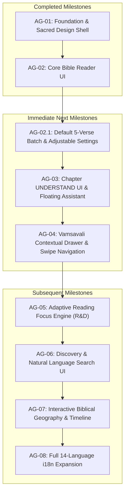

# ANTIGRAVITY MASTER UI FEATURE CHECKLIST — UNDERSTAND BIBLE

> **Product:** Understand Bible  
> **Frontend Lead:** Antigravity  
> **Workspace:** `C:\Understand_bible\02_Codex_Workspace`  
> **Last Updated:** 2026-11-23  
> **Status:** Active Master UI Feature Tracking  

---

## 1. Executive Summary & Progress Overview

| Section | Domain | Total Req. | Completed | In Progress | Pending | Completion % |
|:---|:---|:---:|:---:|:---:|:---:|:---:|
| **A** | **Language and Bible Selection** | 8 | 6 | 1 | 1 | 75% |
| **B** | **Reader Controls** | 8 | 8 | 0 | 0 | 100% |
| **C** | **Voice and Discovery** | 3 | 1 | 0 | 2 | 33% |
| **D** | **UNDERSTAND (Chapter AI Experience)** | 4 | 0 | 1 | 3 | 12% |
| **E** | **Adaptive Reading Focus (R&D Feature)** | 10 | 0 | 0 | 10 | 0% |
| **F** | **Vamsavali (Genealogy Section)** | 5 | 1 | 0 | 4 | 20% |
| **G** | **Geography and Timeline** | 6 | 0 | 0 | 6 | 0% |
| **H** | **Daily Reading** | 4 | 1 | 0 | 3 | 25% |
| **TOTAL** | **All Sections** | **48** | **17** | **2** | **29** | **37.5%** |

---

## 2. Detailed Requirement Breakdown & Implementation Status

### A. LANGUAGE AND BIBLE SELECTION
- [ ] **A.1** — **14 Interface Languages**
  - [x] English (`en`) — Default LTR interface
  - [x] Telugu (`te`) — Indic complex script interface
  - [x] Arabic (`ar`) — RTL bidirectional interface
  - [ ] Hindi (`hi`)
  - [ ] Tamil (`ta`)
  - [ ] Malayalam (`ml`)
  - [ ] Kannada (`kn`)
  - [ ] Bengali (`bn`)
  - [ ] Marathi (`mr`)
  - [ ] Gujarati (`gu`)
  - [ ] Spanish (`es`)
  - [ ] French (`fr`)
  - [ ] German (`de`)
  - [ ] Chinese Simplified (`zh`)
- [ ] **A.2** — **10+ Complete Bible Text Languages** as available and licensed (Currently pilot fixtures in English, Telugu, Arabic; awaiting Codex ingestion pipeline OC-03..OC-06).
- [x] **A.3** — **Choose website language during onboarding** (`apps/web/app/[locale]/onboarding/page.tsx` language selection step).
- [x] **A.4** — **Select primary Bible translation** (`EditionPicker.tsx` modal supporting WEB, KJV, IRV-TE, AR-SVD).
- [x] **A.5** — **Allow optional secondary translation** (`EditionPicker.tsx` modal with comparative selection).
- [x] **A.6** — **Telugu + English side-by-side reading** (`BibleReader.tsx` parallel 2-column comparative layout with IRV-TE and WEB/KJV).
- [x] **A.7** — **English editions such as KJV, WEB, BSB and licensed editions** (WEB & KJV integrated; BSB & licensed queued in Codex catalogue).
- [x] **A.8** — **Translation switching at any time** (Instant toolbar selector without page reload or reading position loss).

---

### B. READER CONTROLS
- [x] **B.1** — **Book, chapter and verse navigation** (`BookPicker.tsx` 3-tab modal with live multilingual search and testament filter pills).
- [x] **B.2** — **Continuous scrolling** (Fluid vertical reading surface with continuous scroll and progress tracking).
- [x] **B.3** — **User-selectable verses per reading batch** (`ReaderSettingsModal.tsx` selectable batches: 5, 10, 20, or Full Chapter).
- [x] **B.4** — **Default five verses, adjustable** (`useReader.ts` initial batch size 5 verses with smooth `IntersectionObserver` auto-streaming).
- [x] **B.5** — **Save exact reading position** (Persists `{ bookId, chapterNumber, verseNumber, editionId }` to `localStorage` on scroll & navigation).
- [x] **B.6** — **Bookmark and notes** (`VerseActionBar.tsx` bookmark toggle with attached notes).
- [x] **B.7** — **Selectable font size and zoom** (`ReaderSettingsModal.tsx` font size slider 14px–28px, line spacing 1.5/1.8/2.2, serif/sans toggle).
- [x] **B.8** — **Manual word and sentence highlighting** (`VerseActionBar.tsx` with 5 sacred highlight colors: Gold, Mint, Coral, Sky, Lavender).

---

### C. VOICE AND DISCOVERY
- [x] **C.1** — **Open a specific book, chapter and verse by voice** (`VoiceNavigator.tsx` via Web Speech API with natural voice command parsing like "John 3", "Genesis 1:1").
- [ ] **C.2** — **Find verses using a remembered word, phrase, incomplete line or natural-language question** (Pending: Search UI connected to Codex Search API).
- [ ] **C.3** — **Open the exact matching result directly in the reader** (Pending: Direct verse deeplink from search results).

---

### D. UNDERSTAND (CHAPTER AI EXPERIENCE)
- [ ] **D.1** — **Floating AI assistant at the bottom-right of the reader** (Floating action pill on `/read` opening contextual assistant drawer).
- [ ] **D.2** — **Quick and detailed explanation of the current chapter** (Two-tier summary: Executive bullet points and exhaustive historical/theological breakdown).
- [ ] **D.3** — **Explain surrounding events, people, context and themes** (Thematic sections for key people, geographical setting, historical occasion, cross-references).
- [ ] **D.4** — **Always provide Scripture references** (Every explanation clause anchors to verified verse citations).

---

### E. ADAPTIVE READING FOCUS — MAJOR R&D FEATURE
- [ ] **E.1** — **Intelligent focus system architecture** (Non-intrusive focus engine estimating reading rhythm).
- [ ] **E.2** — **Estimate reading rhythm** from scrolling speed, pause duration, and progression through verses.
- [ ] **E.3** — **Gently highlight the next reading line or verse** to keep the reader focused without disruption.
- [ ] **E.4** — **Adapt to user-selected reading portions** (Adjusts rhythm based on whether user is reading 5 verses, 1 chapter, or multiple chapters).
- [ ] **E.5** — **Learn preferences only with user consent** (Explicit opt-in prompt with transparent privacy controls).
- [ ] **E.6** — **Keep Scripture text completely unchanged** (No text mutation or altered layout).
- [ ] **E.7** — **Separate temporary focus highlighting from saved personal highlights** (Focus indicator uses temporary CSS pseudo-element/tint distinct from persistent user annotations).
- [ ] **E.8** — **Allow users to pause, disable or customise the feature** (Instant toggle in reader header & detailed controls in settings).
- [ ] **E.9** — **Avoid distracting animations or constant colour changes** (Smooth, subtle opacity transitions).
- [ ] **E.10** — **Ethical reading principle**: System does not equate scrolling speed with comprehension.

---

### F. VAMSAVALI (DEDICATED GENEALOGY SECTION)
- [x] **F.1** — **Dedicated top-level website navigation tab on desktop** (`Sidebar.tsx` has Vamsavali (Genealogy) as a permanent left rail item).
- [ ] **F.2** — **Dedicated visible Vamsavali button/tab on mobile** (Prominent bottom navigation pill or persistent mobile header action).
- [ ] **F.3** — **Left-to-right swipe interaction in the Bible reader** to open its contextual genealogy panel.
- [ ] **F.4** — **Contextual genealogy panel** showing family members and lineages directly connected to the current chapter.
- [ ] **F.5** — **Full genealogy explorer** with interactive zoom, scrolling canvas, ancestor/descendant trees, dynasty branches, and detailed person profiles (AG-16).

---

### G. GEOGRAPHY AND TIMELINE
- [ ] **G.1** — **Interactive biblical map** (Leaflet/MapLibre vector maps with biblical layer overlays).
- [ ] **G.2** — **Ancient and modern place connections** (Bilingual ancient-to-modern place identification with confidence scores).
- [ ] **G.3** — **Journeys and routes** (Exodus, Paul's missionary journeys, Jesus' ministry trails).
- [ ] **G.4** — **Historical events visualization** (Chronological markers and world historical context).
- [ ] **G.5** — **Chapter-specific timeline** (Displays contemporary events alongside active chapter).
- [ ] **G.6** — **People and locations connected to Scripture** (Interactive link pills between text, map, and timeline).

---

### H. DAILY READING
- [ ] **H.1** — **Custom daily portions** (Configurable daily reading length and book preferences).
- [ ] **H.2** — **User-defined verse/chapter goals** (Daily goals: e.g. 1 chapter, 3 chapters, 15 minutes).
- [ ] **H.3** — **Custom notification times** (PWA push notifications / local reminder alarms).
- [x] **H.4** — **Reading plans and progress tracking** (`/plans` route skeleton and `/today` dashboard progress ring / streaks widget).

---

## 3. Implementation Phasing & Task Mapping

---

## 4. API Contracts Required from Codex

To unlock the pending features, the following API contracts will be coordinated with Codex:

1. **Chapter Understand Contract (`/api/v1/understand/chapter`)**:
   - Request: `{ bookId: string, chapter: number, editionId: string, locale: string }`
   - Response: `{ summary: string[], themes: Theme[], people: PersonRef[], historicalContext: string, scriptureQuotes: Quote[] }`
2. **Contextual Genealogy Contract (`/api/v1/vamsavali/chapter`)**:
   - Request: `{ bookId: string, chapter: number }`
   - Response: `{ relatedPeople: PersonSummary[], lineageSnippets: TreeSnippet[] }`
3. **Verse Discovery & Natural Query Contract (`/api/v1/search/natural`)**:
   - Request: `{ query: string, editionId: string, limit: number }`
   - Response: `{ matches: { verseKey: string, text: string, similarity: number, highlights: string[] }[] }`
4. **Biblical Geography Contract (`/api/v1/geography/places`)**:
   - Request: `{ bookId: string, chapter: number }`
   - Response: `{ places: { id: string, ancientName: string, modernName: string, coordinates: [number, number], confidence: string }[] }`

---

## 5. Maintenance & Update Rules
1. Every checkbox must be updated immediately upon PR approval and end-to-end verification.
2. No requirement shall be marked `[x]` without passing automated tests and visual browser verification.
3. Keep this document synchronized with `docs/ANTIGRAVITY_TASKS.md` and `docs/STATUS.md`.
