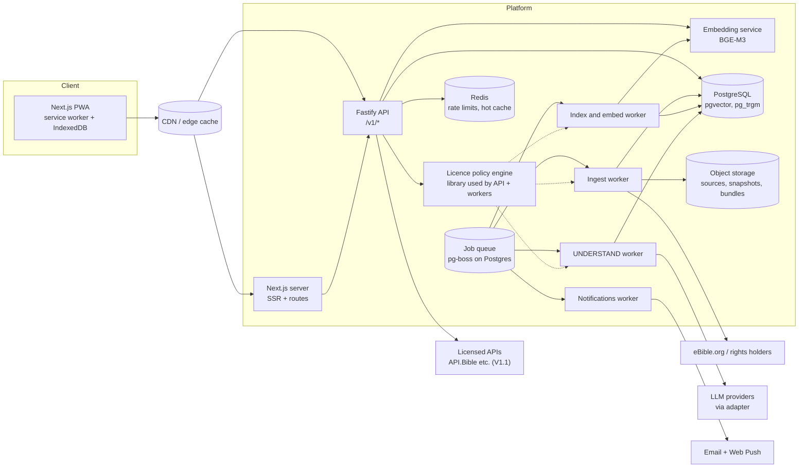

# TECHNICAL ARCHITECTURE

**Status:** Draft for human review · **Date:** 2026-11-21 · Decisions referenced: D-003, D-004, D-010, D-014, D-017, D-019

---

## 1. Summary

A **TypeScript monorepo** with a **Next.js** web app (server-rendered, installable PWA) and a **Fastify** API on **Node.js LTS**, backed by **PostgreSQL** (with `pgvector` and `pg_trgm`), object storage for source files and offline bundles, a small **embedding inference service** for BGE-M3, and batch workers for import, indexing and UNDERSTAND generation. Bible content is immutable per content version, so most reads are served from a **CDN**.

Why this shape:
- Reading traffic dominates and is cacheable → CDN + immutable content versions keep cost and latency low in India and worldwide.
- One language (TypeScript) across web, API, parser and workers lowers coordination cost between the two coding agents; the USFM parser is available as an npm package (WebAssembly build of `usfm3`).
- PostgreSQL covers relational content, user data, full-text, trigram and vector search in one system for V1; a dedicated search engine is a fallback, not a starting assumption (D-010).

## 2. Component diagram



## 3. Technology choices

| Layer | Choice | Notes / alternatives |
|---|---|---|
| Runtime | Node.js current LTS | Pin in `.nvmrc`; same version in CI and containers |
| Package/monorepo | pnpm workspaces + Turborepo | Fast installs; task caching |
| Web | Next.js (current stable, App Router), React, TypeScript | SSR of the first 4 verses for fast first paint; ISR/CDN for chapter pages |
| Styling | CSS Modules or Tailwind with logical properties + design tokens | Antigravity's choice in AG-02, must support RTL and per-script tokens |
| i18n | ICU MessageFormat (e.g. `next-intl` or FormatJS) | Message catalogues in `packages/i18n` |
| Offline | Service worker (Workbox or equivalent) + IndexedDB | Open editions only |
| API | Fastify + TypeScript; OpenAPI 3.1 contract in `packages/contracts` | Generated TS client for the web app; mock server for frontend work |
| Validation | Zod / JSON Schema shared from contracts | |
| Database | PostgreSQL 17+ with `pgvector` (HNSW) and `pg_trgm`; partitioned `verse` table | Managed service in India region |
| Migrations | Drizzle or Kysely migrations (OC-07 decides) | |
| Jobs | pg-boss (queue on Postgres) | Avoids extra infra; Redis-based BullMQ is the alternative |
| Cache / rate limit | Redis | |
| Object storage | S3-compatible bucket | Sources (read-only), licence snapshots, offline bundles |
| Embeddings | BGE-M3 via a text-embeddings inference server (CPU for indexing batch; GPU optional) | MIT-licensed model |
| LLM | Provider-neutral adapter (`packages/ai`); batch use for UNDERSTAND; optional query rewrite (P1) | Provider chosen by evaluation (D-017) |
| Speech | Browser Web Speech API (V1); server ASR adapter (V1.1) | |
| Auth | Maintained OSS auth library in the API (email magic link, Google OAuth; passkeys P1) | OC-12 selects; sessions in httpOnly cookies |
| Email / push | Transactional email provider; Web Push (VAPID) | Region-appropriate provider |
| Observability | OpenTelemetry traces/metrics/logs → managed backend | Licence-policy decisions emitted as events |
| CI/CD | GitHub Actions; preview deploys per PR | Required checks per `TESTING_AND_ACCEPTANCE_CRITERIA.md` |
| Testing | Vitest, Playwright (E2E + visual), axe-core, k6 (load) | |

## 4. Repository layout and ownership (D-019)

```text
/
├─ apps/
│  ├─ web/            # Next.js app (Antigravity)
│  ├─ review/         # Explanation review console UI (Antigravity)
│  └─ api/            # Fastify API + workers entrypoints (OpenCode)
├─ packages/
│  ├─ ui/             # Design system components (Antigravity)
│  ├─ i18n/           # UI message catalogues + locale config (Antigravity)
│  ├─ contracts/      # OpenAPI spec, generated types/client, JSON schemas (OpenCode; Antigravity proposes changes)
│  ├─ refparser/      # Multilingual reference parser + spoken forms (OpenCode)
│  ├─ db/             # Schema, migrations, seed (OpenCode)
│  ├─ ingest/         # USFM acquisition, parsing, versification, validation (OpenCode)
│  ├─ search/         # Normalisation, indexing, retrieval, fusion (OpenCode)
│  ├─ ai/             # LLM adapter, UNDERSTAND pipeline, validators (OpenCode)
│  └─ policy/         # Licence policy engine (OpenCode)
├─ data/              # Canon definitions, book names, plans, curated study data, versification overrides (OpenCode)
├─ e2e/               # Playwright journeys & visual baselines (Antigravity)
├─ infra/             # IaC, Docker, compose, CI workflows (OpenCode)
├─ rights/            # NOT in public repo: signed permissions (human lead)
└─ docs/              # Planning docs (Chief Architect)
```

Root config files (`package.json`, `pnpm-workspace.yaml`, `turbo.json`, lint/format configs) are owned by OpenCode (OC-01). Antigravity requests changes through PRs labelled `root-config`; the human lead approves conflicts.

## 5. Request flows

### 5.1 Open a chapter
1. Browser requests `/te/read/tel-irv/GEN.1` → CDN → Next.js SSR.
2. SSR calls `GET /v1/editions/tel-irv/chapters/GEN.1?limit=4` (CDN-cached by content version) and renders verses 1–4 + header.
3. Client hydrates, fetches remaining verses (same endpoint with `from=5`), then prefetches next chapter.
4. Scroll idle → client saves position locally; if signed in, `PUT /v1/me/position` (debounced).

### 5.2 Parallel
`GET /v1/parallel?left=tel-irv&right=eng-kjv&book=GEN&ch=1` returns aligned rows (precomputed per content-version pair and cached).

### 5.3 Verse Finder
`GET /v1/search?q=…&lang=te&edition=tel-irv` → refparser → lexical (SQL) + semantic (query embedding via TEI → pgvector) → RRF → map to user edition → response with match types. Results cached briefly per normalised query.

### 5.4 UNDERSTAND
Read path is static (`GET /v1/explanations/GEN.1?depth=quick&lang=te`, CDN). Generation is offline in W3 (queue), never in the request path.

## 6. Deployment

| Item | Proposal |
|---|---|
| Region | Primary in India (e.g. Mumbai region of a major cloud) for latency and DPDP alignment; CDN worldwide (D-014) |
| Environments | `dev` (local compose), `preview` (per PR), `staging` (full data), `prod` |
| Containers | API, workers, TEI as containers; web on a Next.js-capable host or container |
| Database | Managed PostgreSQL with PITR backups; read replica when needed |
| Secrets | Cloud secret manager; no secrets in repo; API keys for licensed providers server-side only |
| Scaling | API stateless, horizontal; workers scaled by queue depth; TEI scaled for indexing bursts |
| DR | Daily snapshot + PITR; object storage versioning; documented restore drill before launch |

## 7. Caching strategy

| Content | Cache key | TTL |
|---|---|---|
| Chapter/parallel JSON | edition + content_version + range | Immutable (purge on publish) |
| Edition/canon lists | language + canon | 1 h |
| Explanations | chapter + depth + lang + version | Immutable per version |
| Search | normalised query + lang + edition + filters | 10 min |
| Licensed API text (V1.1) | provider rules (e.g. ≤30 days for API.Bible) | Per `edition_rights.cache_ttl_days` |
| User data | not cached at CDN | — |

## 8. Licence policy engine (OC-29)

A small library used by API and workers:

```ts
assertAllowed(editionId, action: 'display'|'host'|'offline'|'commercial'|'ai_process'|'embed'|'tts', ctx)
```

- Reads `edition_rights`; denies by default; logs every denial with reason.
- Workers call it before embedding, AI packet building, bundle generation and TTS.
- API decorates responses with `display_only`, `attribution_short`, `copyright_url`.
- Unit-tested against the licensing matrix CSV (`docs/data/edition_catalogue.csv`) to prevent drift.

## 9. Security architecture (summary — see security doc)

TLS everywhere; strict CSP; httpOnly SameSite cookies; CSRF protection on state-changing routes; per-route rate limits; user notes encrypted at application level with a separate key; least-privilege DB roles (reader role for content APIs, writer role for user data, ingest role for content); audit log for content publication and explanation review.

## 10. Observability and SLOs

- SLOs: reading APIs 99.5% availability; p95 latency per NFR-PERF; error budget alerts.
- Dashboards: chapter latency by region, CDN hit ratio, search latency and zero-result rate, explanation report rate, licence denials, ingest validation failures.
- Tracing across web → API → DB/TEI.

## 11. Cost levers (no prices assumed)

- CDN hit ratio is the main lever for reading cost.
- Embeddings computed once per content version; ~31k verses × number of embed-permitted editions × 2 granularities (verse, window).
- UNDERSTAND generation is batch and one-off per version; translation is per language.
- Query-time LLM use limited to P1 query rewriting with caching.

## 12. Architecture risks

| ID | Risk | Mitigation |
|---|---|---|
| AR-1 | Postgres FTS weak for Indic/CJK relevance | Eval gate (OC-17); fallback to Meilisearch/OpenSearch (D-010) |
| AR-2 | Versification mapping bugs break parallel view and highlights | TVTMS-based map + edition overrides + validation V-07 + golden parallel tests |
| AR-3 | Font payload too large (CJK, multiple Indic) | `unicode-range` subsets; load only active scripts |
| AR-4 | Web Speech API gaps | Feature detection; V1.1 server ASR |
| AR-5 | LLM provider terms change | Adapter + D-017 checklist; batch generation means no live dependency for reading |

## 13. Sources (checked 2026-11-21)

- pgvector, PostgreSQL FTS and trigram are standard PostgreSQL extensions (no external claim relied on).
- BGE-M3 (MIT): https://huggingface.co/BAAI/bge-m3
- usfm3 parser (MIT; npm/WASM, Python, Rust): https://docs.rs/crate/usfm3/0.1.8/source/README.md
- Web Speech API on-device: https://developer.mozilla.org/docs/Web/API/Web_Speech_API/Using_the_Web_Speech_API
- API.Bible caching and FUMS: https://care.api.bible/article/401-caching-content ; https://docs.api.bible/resources/fair-use
