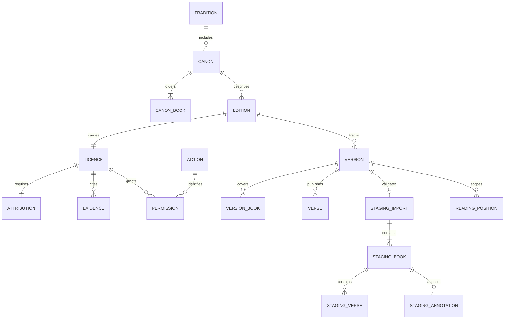

# Rights-first PostgreSQL foundation

Use PostgreSQL 17+, `psql`, and Python 3.10+ on a dedicated local project cluster. Set `PGHOST`, `PGPORT`, `PGDATABASE`, `PGUSER` and a private libpq password file. `PSQL` can point to an absolute executable. The migration account owns the schemas and creates the cluster-wide NOLOGIN group `ub_reader`. Reserve this role name for this database. The API's eventual login should inherit only that role, with no ownership, superuser, BYPASSRLS or staging grants.

```sh
python -B packages/db/foundation.py up
python -B packages/db/foundation.py seed
python -B packages/db/test_rights.py
node packages/db/test_reader_queries.mjs
```

The seed verifies the private source files and evidence against their receipts. It updates reviewed registry data transactionally and replaces each edition's complete grant and evidence sets. A missing grant denies the action. A repeat seed preserves publication state. The migrations take an advisory transaction lock and record their checksums. On a disposable empty cluster, `python -B packages/db/test_migrations.py` exercises up/up/down/up. The `down` command removes all managed content, staging and user tables. Use the disposable migration test cluster for rollback testing.



A version is identified by edition plus archive SHA-256. Edition notice date, embedded source date, notice-member checksum and retrieval timestamp have distinct columns. The production verse table is hash-partitioned by edition. `reader.translations` and `reader.verses` are security-barrier views. They require affirmative publication, verified licence, evidence, attribution and current host, display and commercial grants. The commercial check keeps publication compatible with either possible business model. An offline bundle, embedding, AI or speech worker requires a separate fixed-action authorization before access. The reader role has no access to raw tables. User-position RLS is forced and has no public policies before authentication is implemented. Study tables are reserved for a later scope.

The checked-in TypeScript queries accept a reader connection and bind edition, checksum and paging values. The migration and ingestion commands use native SQL and libpq's command-line client. No ORM or runtime package is needed for this pilot. [Reader queries](reader.ts) · [Browser and service contract](../contracts/reader-proposal.md)

Migration 004 separates native archive order and coverage from tradition membership. Reapply the seed after upgrading. Each source book records its chapter and verse-marker counts. The gated catalogue can return native source order or a reviewed alternate profile with gaps explicitly labelled. A single query returns the edition, version, display rights, attribution and books from one database snapshot. Greek and Slavonic Orthodox profiles have separate identities and remain metadata-only pending reviewed definitions. [Canon research](../../docs/CANON_AND_TRADITION_RESEARCH.md)
